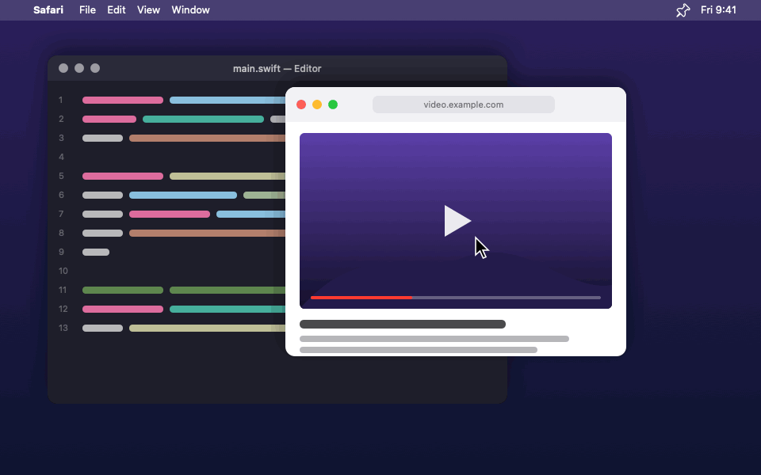

<p align="center">
  
</p>

<h1 align="center">PinMac</h1>

<p align="center">
  <strong>Keep any window on top, on macOS.</strong><br>
  A small, free menu-bar app inspired by the <em>Always On Top</em> tool in Microsoft PowerToys.
</p>

<p align="center">
  <a href="../../releases/latest"></a>
  
  <a href="LICENSE"></a>
</p>

<p align="center">
  
  <br><sub>Illustration of PinMac in use.</sub>
</p>

Press **⌃⌘T** to pin the window you're working in. It gets a colored border
and stays visible above everything else, even full-screen apps. Press **⌃⌘T**
again to unpin it.

## Features

- **Pin any window** with a shortcut, from any app
- **Crop** a pinned window so only part of it floats on top, like just the
  video in a browser tab (**⌃⌘R**)
- **Opacity**: make a floating window see-through (**⌃⌘O**)
- **Click-through**: clicks pass through a floating window to what's underneath
- **Colored border** around pinned windows, in any color you like
- **Works everywhere**: pinned windows follow you to every Space and appear
  over full-screen apps
- **Custom shortcuts**, sounds, and launch at login
- **Private**: no accounts, no tracking, nothing leaves your Mac

## Install

1. Download `PinMac-x.y.z.dmg` from the [latest release](../../releases/latest).
2. Open it and drag **PinMac** into **Applications**.
3. Open PinMac. Because it isn't notarized by Apple (that needs a paid
   developer account), macOS blocks it the first time:
   - Click **Done** on the warning.
   - Open **System Settings → Privacy & Security**, scroll down, and click
     **Open Anyway** next to the PinMac message. Confirm with your password.
   - Or, in Terminal: `xattr -dr com.apple.quarantine /Applications/PinMac.app`
4. The welcome window walks you through two permissions in
   System Settings → Privacy & Security:
   - **Screen Recording**: shows a live copy of a pinned window while other
     windows cover it.
   - **Accessibility**: brings the real window to the front when you click a
     pinned window.
5. After allowing Screen Recording, quit and reopen PinMac (macOS requires it).

Requires macOS 14 Sonoma or later, on Apple Silicon or Intel.

## Quick start

1. Click any window, then press **⌃⌘T**. A border appears: it's pinned.
2. Click another app. The pinned window stays on top.
3. Click the pinned window to work in it.
4. Want just part of it on top? While you're in the pinned window, press
   **⌃⌘R**, drag a box around the part you want, and press **Return**.
5. Press **⌃⌘R** again to show the whole window, or **⌃⌘T** to unpin.

PinMac lives in the menu bar under the 📌 icon. There's no Dock icon.

## Shortcuts

| Shortcut | What it does |
| --- | --- |
| **⌃⌘T** | Pin or unpin the window you're working in |
| **⌃⌘R** | In a pinned window: open the crop view, or show it whole again if it's cropped. Elsewhere: show all cropped windows whole again |
| **⌃⌘O** | Step opacity 100% → 80% → 60% → 40% → 20%. Changes the pinned window under the pointer, else the one you're in, else all |
| **Return** | In the crop view: use the selected part |
| **Esc** | In the crop view or while recording a shortcut: cancel |

Change any shortcut from 📌 → **Shortcuts…**: click the box, then press the
new keys. Shortcuts must include ⌃, ⌥ or ⌘.

## Menu reference

**📌 menu**

| Item | What it does |
| --- | --- |
| Pin / Unpin Frontmost Window | Same as ⌃⌘T |
| Shortcuts… | Change the pin, crop, and opacity shortcuts |
| *Pinned* → a window | Options for that window (see below) |
| Unpin All | Unpin every window |
| Border → Show Border | Turn the outline on or off |
| Border → a color | Accent color, 8 presets, or *Custom Color…* (picker, hex codes, saved colors) |
| Smooth Switching | Keeps pinned windows' copies live, so switching apps never shows an old frame (the purple recording indicator stays on) |
| Play Sounds | Sounds when pinning and unpinning |
| Launch at Login | Start PinMac when you log in |
| Welcome Guide… | Reopen the setup and tips window |

**Options for each pinned window** (📌 → *Pinned* → the window)

| Item | What it does |
| --- | --- |
| Opacity While Floating | 100% to 20%: how see-through the window is while it floats over others (⌃⌘O) |
| Click Through | Clicks go to the windows underneath |
| Crop to Part of Window… | Choose the part that floats on top (⌃⌘R) |
| Change Crop… / Reset to Whole Window | Adjust or remove the crop |
| Bring to Front | Switch to the real window |
| Unpin | Stop pinning this window |

## Picture-in-picture tips

- **Watch a video while you work:** pin the browser window and crop it to just
  the video with ⌃⌘R. The cropped part floats where it is in the window, so
  move the window first to place the video where you want it.
- **Follow a tutorial or reference:** pin it, hover over it and press ⌃⌘O
  until it's 60%, and turn on *Click Through*. You can see it and keep working underneath.
- With *Click Through* on, use *Bring to Front* (or ⌘-Tab) to work in the
  pinned window.

## How it works

Unlike Windows, macOS has **no public API that lets one app make another
app's window float**. Older tools injected code into other apps, which modern
macOS (with System Integrity Protection) blocks.

PinMac uses a different approach:

1. It captures the pinned window on its own with **ScreenCaptureKit**, which
   keeps working even when other windows cover it.
2. When something covers the pinned window, PinMac shows that live capture in
   a borderless panel placed exactly over the real window, above the other
   windows.
3. When the real window is already in front, the copy hides, so you're
   working with the real window directly.
4. Clicking the copy brings the real window to the front through the
   **Accessibility API**.
5. Opacity, click-through, and cropping all apply to that floating copy.

### Limitations

- While another app is in front, a pinned window is a live *view*: the first
  click brings the real window forward, and the next clicks go to it.
- macOS doesn't let one app make another's real window transparent, so
  opacity applies only while the window is floating over others.
- On another Space or over a full-screen app, clicking a pinned window
  switches back to the Space it lives on.
- The border hides while a window is being dragged or resized, and comes
  back as soon as it stops.

## Privacy

PinMac has no accounts, analytics, or network access. Screen Recording is used
only to show a live copy of the windows you pin; frames stay in memory and are
never saved or sent anywhere. The code is open, so you can check.

## Uninstall

1. Quit PinMac (📌 → **Quit PinMac**) and drag it from Applications to the Trash.
2. Optional: remove its settings with `defaults delete io.github.ellediablo.PinMac`,
   and remove PinMac from Screen Recording and Accessibility in
   System Settings → Privacy & Security.

## Troubleshooting

**The purple recording icon appears in the menu bar.** macOS shows it whenever
an app captures the screen, and apps can't hide it. PinMac only captures while
a pinned window is covered, so it goes away when your pinned windows are in front
(unless *Smooth Switching* is on).

**Pinning does nothing, or the pinned window doesn't float.** Open 📌 →
**Welcome Guide…** and check both permissions show *Allowed*. If you just
allowed Screen Recording, click *Reopen PinMac*.

**A shortcut doesn't work.** Another app may already use it. Pick a different
one in 📌 → **Shortcuts…**.

**macOS says PinMac "can't be opened" or is "damaged".** That's Gatekeeper
blocking an app that isn't notarized. Use **Open Anyway** or the `xattr`
command from [Install](#install).

**Permissions stopped working after updating.** In System Settings → Privacy &
Security, remove PinMac from Screen Recording and Accessibility, then allow it
again.

## Build from source

You need the Xcode Command Line Tools (`xcode-select --install`) or Xcode.

```bash
git clone https://github.com/ElleDiablo/PinMac.git
cd PinMac
scripts/build.sh 1.1.0      # → build/PinMac.app and build/PinMac-1.1.0.dmg
open build/PinMac.app
```

> Local builds are ad-hoc signed by default, so macOS may ask for permissions
> again after each rebuild. To avoid that, sign with your own certificate:
> `SIGN_IDENTITY="Apple Development: you@example.com" scripts/build.sh`
> (list yours with `security find-identity -v -p codesigning`).

### Project layout

```
Sources/PinMac/
  main.swift               app entry point (menu-bar only)
  AppDelegate.swift        menu-bar menu, shortcuts, popovers
  PinManager.swift         tracks pinned windows ~30×/second and keeps them stacked
  PinnedWindow.swift       the border / floating copy for one window
  WindowStream.swift       ScreenCaptureKit live capture
  WindowList.swift         reads the on-screen window list
  Accessibility.swift      raises windows, permission helpers
  CropSelector.swift       overlay for choosing the part of a window to float
  HotKey.swift             global shortcut registration (Carbon)
  Shortcut.swift           shortcut model, storage, and Shortcuts popover
  BorderColorPicker.swift  border color popover
  Welcome.swift            welcome guide and permission setup
  About.swift              About window
  HostingWindow.swift      fixed-size windows for SwiftUI views
  HUD.swift                brief on-screen labels (e.g. "Opacity 60%")
  PinShape.swift           PinMac's pin, shared by the app and menu-bar icons
scripts/
  build.sh                 builds the .app and .dmg
  make-icon.swift          draws the app icon (delete Resources/AppIcon.icns to regenerate)
docs/                      README images
```

### Releasing

Push a version tag and GitHub Actions builds the DMG and attaches it to a release:

```bash
git tag v1.1.0
git push origin v1.1.0
```

## Contributing

Issues and pull requests are welcome! See [CONTRIBUTING.md](CONTRIBUTING.md).
To report a security problem, see [SECURITY.md](SECURITY.md).

## License

[MIT](LICENSE)
